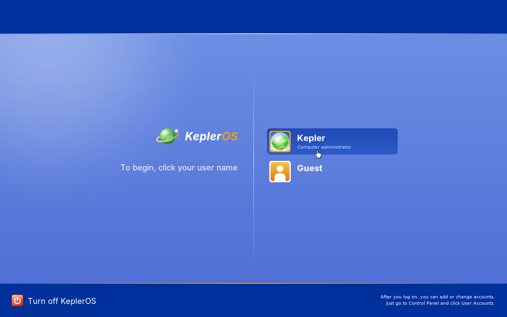
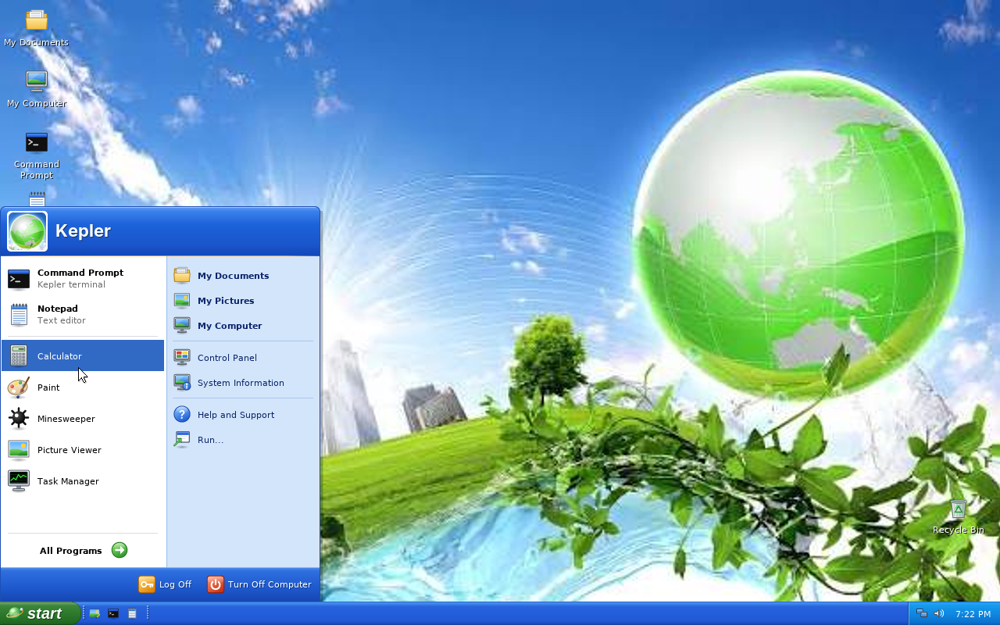
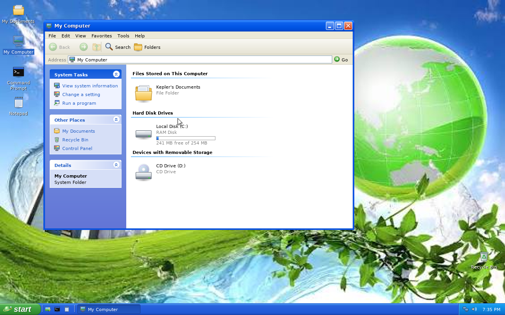
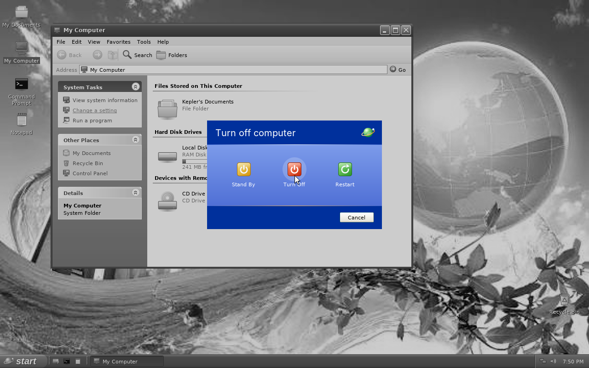

kepleros kernel
_________________
this is a newly based os made by Lennon Helman and with the help of claude code


KeplerOS is a small 32-bit x86 operating system written in C. It boots
straight into a graphical desktop inspired by Windows XP's Luna look, with
the green-globe photo in `assets/stockwallpaper` as its wallpaper.
Everything on screen is drawn by the kernel itself: there is no libc, no
bootloader code of its own (it is a Multiboot kernel) and no external
graphics or font libraries.

## What's inside

- **Kernel:** Multiboot entry, GDT/IDT, remapped 8259 PICs, a 1000 Hz PIT,
  a first-fit heap, the CMOS clock, PCI enumeration, ACPI power-off and reboot.
- **Drivers:** PS/2 keyboard and wheel mouse, Bochs/QEMU VBE (BGA) linear
  framebuffer at 1280x800x32, or a GRUB-provided framebuffer, and the PC
  speaker for beeps.
- **Graphics:** a dirty-rectangle compositor, antialiased rounded shapes,
  gradients, pre-rendered antialiased fonts, vector icons rasterised at boot
  with 4x4 supersampling, a baseline **JPEG decoder** and bicubic scaling
  for the wallpaper.
- **Shell:** boot splash, welcome/login screen, desktop icons (drag,
  rename, delete, right-click menus), a taskbar with a Start button, quick
  launch, window buttons and a clock, a two-column Start menu with All
  Programs, a window manager (move, resize, minimise, maximise, modal
  dialogs), Turn Off / Log Off dialogs with the grayscale fade.
- **Apps:** Notepad, Calculator, Command Prompt (dir, cd, type, tree, echo
  with `>` redirection, calc, neofetch, tasklist...), My Computer / Explorer,
  Picture Viewer, Paint, Minesweeper, Task Manager with live CPU and memory
  graphs, Display Properties (switch backgrounds), System Properties, Run
  and About.
- **Files:** an in-memory file system (shown as drive C:) with a few
  starter documents. Files you create live until you power off.

| | |
| --- | --- |
|  |  |
|  |  |

## Build and run

You need `gcc` that can target i386 (`-m32`), GNU `ld`, `make` and
`qemu-system-i386`.

```sh
make            # builds build/kepler.elf
make run        # boots it in QEMU
make iso        # optional: a GRUB CD image (needs grub-mkrescue + xorriso)
```

Click your user name on the welcome screen (or press Enter) to log in.

Handy keys: **Win** opens Start, **Ctrl+Alt+Del** opens Task Manager,
**Alt+Tab** cycles windows, **Alt+F4** closes the active window,
**Win+D** shows the desktop, **Win+E** opens My Computer and **Win+R** opens Run.

## Layout

| Path | What |
| --- | --- |
| `boot/` | Multiboot header, entry point, interrupt stubs |
| `kernel/` | CPU setup, heap, timer, console, clock, PCI, power, `kmain` |
| `drivers/` | keyboard, mouse and framebuffer |
| `gfx/` | drawing, fonts, icons, cursors, JPEG decoder |
| `ui/` | shell main loop, window manager, desktop, taskbar, Start menu, menus, widgets, dialogs, splash/welcome |
| `apps/` | the applications |
| `fs/` | the RAM file system |
| `assets/` | the wallpaper, linked into the kernel image |
| `tools/genfont.py` | regenerates `gfx/fontdata.c` from TrueType fonts (needs Pillow) |
| `tools/qemu_drive.py` | boots QEMU headless and drives it over QMP to take screenshots |

## Credits

- Fonts are rasterised from DejaVu Sans / Sans Mono (Bitstream Vera
  license), Liberation Sans (SIL OFL 1.1) and Inter (SIL OFL 1.1).
- The wallpaper is the stock image supplied by the project owner.
- The look is inspired by Windows XP. KeplerOS is not affiliated with
  Microsoft and uses no Microsoft artwork; its icons and logo are drawn in
  code.
