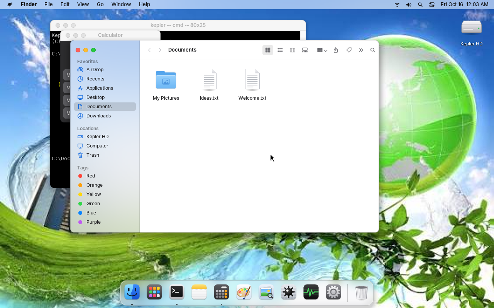
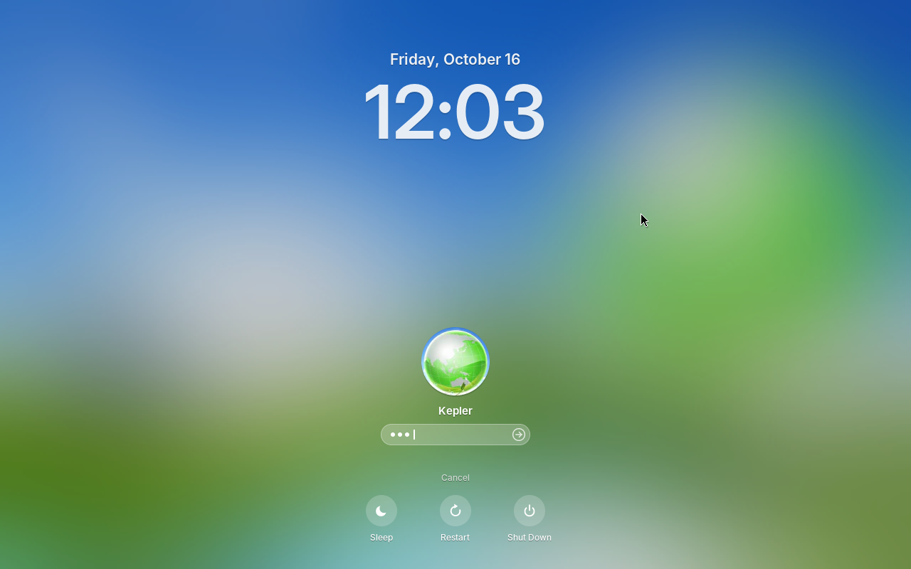
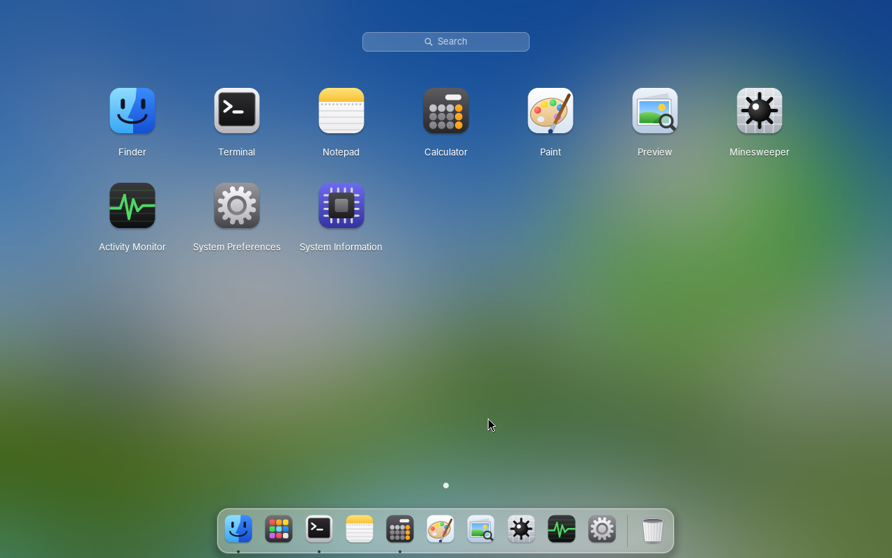
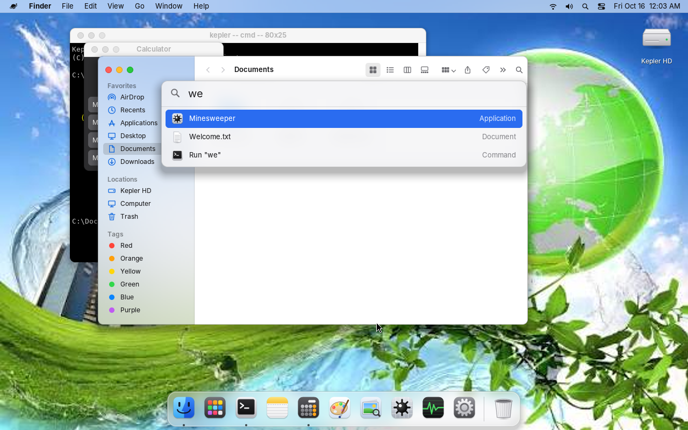
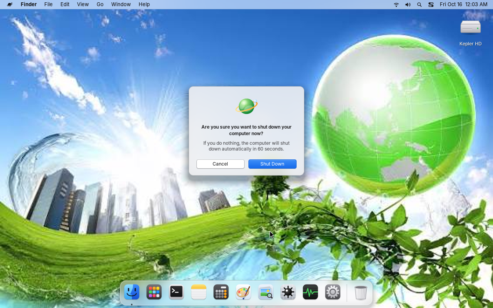

kepleros kernel
_________________
this is a newly based os made by Lennon Helman and with the help of claude code



KeplerOS is a small 32-bit x86 operating system written in C. It boots
straight into a graphical desktop styled after macOS Big Sur, with the
green-globe photo in `assets/stockwallpaper` as its wallpaper. Everything on
screen is drawn by the kernel itself: there is no libc, no bootloader code of
its own (it is a Multiboot kernel) and no external graphics or font libraries.

## What's inside

- **Kernel:** Multiboot entry, GDT/IDT, remapped 8259 PICs, a 1000 Hz PIT,
  a first-fit heap, the CMOS clock, PCI enumeration, ACPI power-off and reboot.
- **Drivers:** PS/2 keyboard and wheel mouse, Bochs/QEMU VBE (BGA) linear
  framebuffer at 1280x800x32, or a GRUB-provided framebuffer, and the PC
  speaker for beeps.
- **Graphics:** a dirty-rectangle compositor, antialiased rounded shapes,
  soft drop shadows, box blur for translucent "vibrancy" surfaces (the menu
  bar, dock, menus and Spotlight blur whatever is behind them), pre-rendered
  antialiased fonts (Inter, standing in for San Francisco), vector icons
  rasterised with 4x4 supersampling, a baseline **JPEG decoder** and bicubic
  scaling for the wallpaper.
- **Sign-in screen:** the wallpaper, frosted, with a big clock and date,
  account pictures, a password field (it shakes on a wrong password and
  then shows the hint), and Sleep / Restart / Shut Down. Lock Screen and
  waking from sleep come back to it with your windows still open.
- **Desktop:** a translucent menu bar with the Kepler menu, the frontmost
  app's name and menus, status icons and the clock; a dock with running-app
  dots, bouncing launches, minimised-window thumbnails and the Trash; desktop
  icons down the right edge; Launchpad; Spotlight (apps, files, or any
  command); Big Sur windows with traffic lights, rounded corners and
  shadows; macOS-style alerts and shut down / restart / log out prompts.
- **Apps:** Finder (sidebar, toolbar, icon view), Notepad, Calculator,
  Terminal (dir, cd, type, tree, echo with `>` redirection, calc, neofetch,
  tasklist...), Paint, Preview, Minesweeper, Activity Monitor with live CPU
  and memory graphs, System Preferences (desktop background), System
  Information and About This Kepler.
- **Files:** an in-memory file system (Kepler HD) with a few starter
  documents. Files you create live until you power off.

| | |
| --- | --- |
|  |  |
|  |  |

## Build and run

You need `gcc` that can target i386 (`-m32`), GNU `ld`, `make` and
`qemu-system-i386`.

```sh
make            # builds build/kepler.elf
make run        # boots it in QEMU
make iso        # optional: a GRUB CD image (needs grub-mkrescue + xorriso)
```

Pick **Kepler** on the sign-in screen (or press Enter) and type the password
**`kepler`**. **Guest** signs in without one.

The Windows key plays the Command key: tapping it opens **Launchpad**,
**Win+Space** (or Win+R) opens **Spotlight**, **Win+Q/W** closes the window,
**Win+M** minimises it, **Win+H** hides the app, **Win+L** locks the screen,
**Win+D** shows the desktop and **Win+E** opens a Finder window.
**Ctrl+Alt+Del** opens Activity Monitor, **Alt+Tab** cycles windows and
**Alt+F4** closes the active window. Menu shortcuts written `Ctrl+S` are
shown as Command-S.

## Layout

| Path | What |
| --- | --- |
| `boot/` | Multiboot header, entry point, interrupt stubs |
| `kernel/` | CPU setup, heap, timer, console, clock, PCI, power, `kmain` |
| `drivers/` | keyboard, mouse and framebuffer |
| `gfx/` | drawing, fonts, icons, cursors, JPEG decoder |
| `ui/` | shell main loop and compositor, window manager, desktop, menu bar, dock, Launchpad and Spotlight, menus, widgets, alerts, boot and sign-in screens |
| `apps/` | the applications |
| `fs/` | the RAM file system |
| `assets/` | the wallpaper, linked into the kernel image |
| `tools/genfont.py` | regenerates `gfx/fontdata.c` from TrueType fonts (needs Pillow) |
| `tools/qemu_drive.py` | boots QEMU headless and drives it over QMP to take screenshots |

## Credits

- Fonts are rasterised from DejaVu Sans / Sans Mono (Bitstream Vera
  license), Liberation Sans (SIL OFL 1.1) and Inter (SIL OFL 1.1).
- The wallpaper is the stock image supplied by the project owner.
- The look is inspired by macOS Big Sur. KeplerOS is not affiliated with
  Apple and uses no Apple artwork or fonts; its icons and logo are drawn in
  code.
